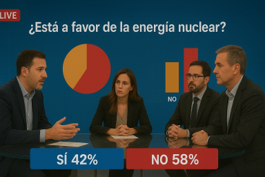

# Software Design Laboratory Class

## ✏️ Instructions

An implementation of an application that keeps track of votes received through phone calls for a survey conducted by a live television program is provided.

Each time a call is received, it is counted and certain charts are updated live to show the current count. These charts appear in different parts of the screen (on the studio background screen or overlaid on the image), although their position is not relevant for this exercise.

### Requirements

Detect the improvement points in the design and redesign it using one or more patterns.

**NOTE**. The questions will always be yes/no answers (there is no need to generalize that part to support other answers).

### Subsequent modifications to be made

We will be hired to create vote counting applications for five television programs from other networks. However, the same application cannot be used for all of them since each one has its particular requirements. Nevertheless, the goal is to reuse as much code as possible to make the development profitable.

**IMPORTANT**: Create, for _each_ of the new programs, a `Program{n}` class (with its own `main` method) that implements the requirements of that program.

The description of each program is as follows:
1. For the next television program, they want a **status line** to also be drawn when a vote is received. A status line is, as already shown in the image above, a text line indicating the number of votes for each option ("_YES x% / NO x%_").

2. In another television program, they do not want the **bar chart** to be drawn (but they do want the pie chart and the status line).

3. In the next television program, instead of drawing it with each vote, the **pie chart** should only be drawn starting from the third vote. That is, it is drawn for the first time on vote 3 and from then on it is drawn with each vote. The status line will continue to be shown from the first vote.

4. In another television program, they want the **bar chart** to be back, but now it will only be drawn every 3 votes (with the first, fourth, seventh, etc.). The other charts will continue to be drawn as indicated in the previous point.

5. In the last television program, they want the **status line** to start being printed from the fourth vote and from then on to be shown only every two votes (it will be printed on the fourth, sixth, eighth, etc.). The other charts will continue to be drawn as indicated in the previous point.

**NOTE**: Each point _n_ above indicates the modifications to be made in that program compared to the program before it (therefore, anything not expressly mentioned will remain the same as in the previous programs).

## 💻 Submission Instructions

To submit your solution:
- Open the terminal.
- Navigate to the folder where this `README.md` file is located.
- Run `git add -A`.
- Run `git commit -m "final code"`.
- Run `git push`.

**⚠️ IMPORTANT NOTE:** This repository will be **deleted** at the end of the course. Make sure to save any code you want to keep elsewhere.

## ✅ Exercise Solution

The solution to **this exercise** can be found in [this repository](https://github.com/org-raul-ds/08_Survey_solution.git), which will be available during the next lab session (it is currently disabled, so the link will produce an error).

The solution to **last week's exercise** can be found in [this repository](https://github.com/org-raul-ds/07_Encrypt_solution.git).
